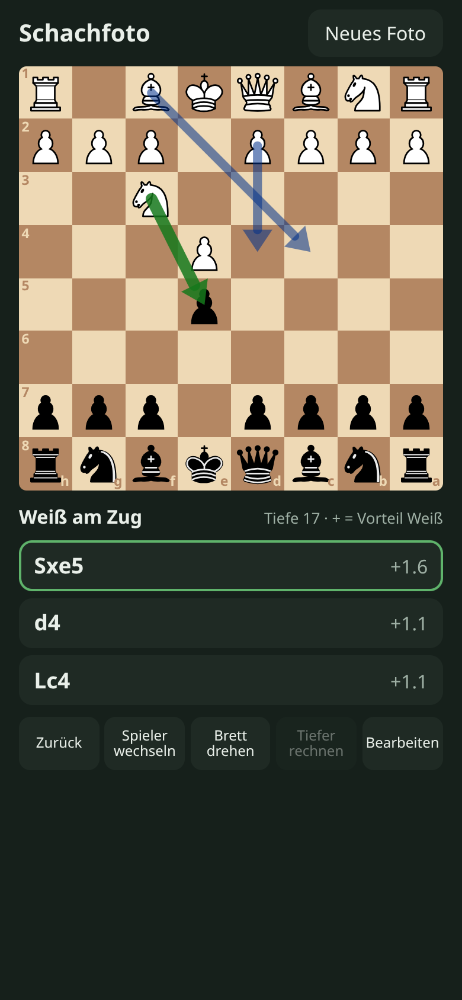

# Schachfoto

Photograph a chess board, get the position recognised, and see the best moves.

[](https://github.com/michaelkrisper/schachfoto/actions/workflows/ci.yml)
[](LICENSE)
[](https://schachfoto.pages.dev)

**Live: https://schachfoto.pages.dev**

A progressive web app for Android and iPhone, hosted on Cloudflare Pages. The
user interface is in German.



## Features

- Board recognition from a photo taken from above or at an angle
- Board editor with uncertain squares highlighted; only positions that can
  occur in a real game are accepted (one king per side, at most eight pawns,
  every extra piece costs a pawn)
- Side to move and castling rights chosen by the user (a photo cannot show them)
- Stockfish 19 in the browser: the three best moves with evaluation, shown as
  arrows on the board
- Keep playing: drag and drop, tap piece and target, or tap a suggestion;
  undo, switch side to move, flip the board
- Installable and offline-capable for the engine part (service worker)

## How it works

1. **Photo:** the phone scales the image down to at most 1568 px on the long edge and posts it to the
   Pages Function `functions/api/recognize.js`.
2. **Recognition:** the function asks Google Gemini (free tier) for the
   position as eight rank strings using structured output. Models are tried in
   order (3.6 Flash, 3 Flash Preview, 3.8 Flash); on 429/500/503/524 the next
   one is used, since each has its own quota. A photo taken from Black's side
   and read upside down is turned back by `orientByPawns`.
3. **Review:** the recognised position is shown in the editor for correction.
4. **Analysis:** Stockfish 19 (lite, single-threaded WASM) runs in a Web
   Worker behind a small UCI wrapper (`public/js/engine.js`). The
   single-threaded build needs no cross-origin isolation, so it also runs on iOS.

The function is protected by an access code (`x-access-code` header) so the
free quota is not used by others. Without `GEMINI_API_KEY` recognition answers
503, but the board can still be set up by hand and analysed.

| Path | Contents |
|---|---|
| `public/` | Static PWA, vanilla ES modules, no build step |
| `public/js/position.js` | Board model, FEN, plausibility checks, orientation |
| `public/js/engine.js` | UCI wrapper around the Stockfish worker |
| `functions/api/recognize.js` | Pages Function: access code, Gemini call, validation |
| `tests/` | `node:test` unit tests for board logic, UCI wrapper and the function (mocked `fetch` and worker) |
| `scripts/browser-check.mjs` | Headless Chrome smoke test of the full UI flow |

## Privacy

Move analysis runs entirely on the device. Recognition uploads the photo to
Google Gemini via the Pages Function; on the free tier Google may use uploaded
images to improve its models. Nothing is stored by the app's server.

## Development

Requires Node 24.

```sh
npm install
cp .dev.vars.example .dev.vars    # fill in GEMINI_API_KEY and ACCESS_CODE
npm run dev                       # http://localhost:8793
npm run check                     # Biome lint/format + unit tests
npm test                          # unit tests only
npm run lint:fix                  # apply Biome fixes
node scripts/browser-check.mjs    # smoke test against the dev server (needs google-chrome)
```

`node scripts/browser-check.mjs https://schachfoto.pages.dev` runs the smoke
test against the deployed site; `VIEWPORT=375x667` simulates a small phone.

When changing frontend files, bump `VERSION` in `public/sw.js`.

## Deployment

Every push to `main` runs the `CI` workflow (lint and tests). If that passes,
the `deploy` job publishes `public/` to Cloudflare Pages, provided the
repository secret `CLOUDFLARE_API_TOKEN` and variable `CLOUDFLARE_ACCOUNT_ID`
are set. Manual deploy: `npm run deploy`.

The function's secrets are set from an interactive terminal (a pipe without a
TTY stores an empty value):

```sh
npx wrangler pages secret put GEMINI_API_KEY --project-name schachfoto
npx wrangler pages secret put ACCESS_CODE --project-name schachfoto
```

## License

The project's own code is licensed under the [MIT License](LICENSE).
Bundled third-party files keep their licenses:

- [Stockfish](https://github.com/official-stockfish/Stockfish), WASM build by
  [stockfish.js](https://github.com/nmrugg/stockfish.js): GPLv3, see
  `public/vendor/STOCKFISH-COPYING.txt`
- [chess.js](https://github.com/jhlywa/chess.js): BSD-2-Clause, see
  `public/vendor/CHESSJS-LICENSE.txt`
- Piece set "cburnett" by Colin M.L. Burnett (`public/pieces/`): CC BY-SA 3.0
